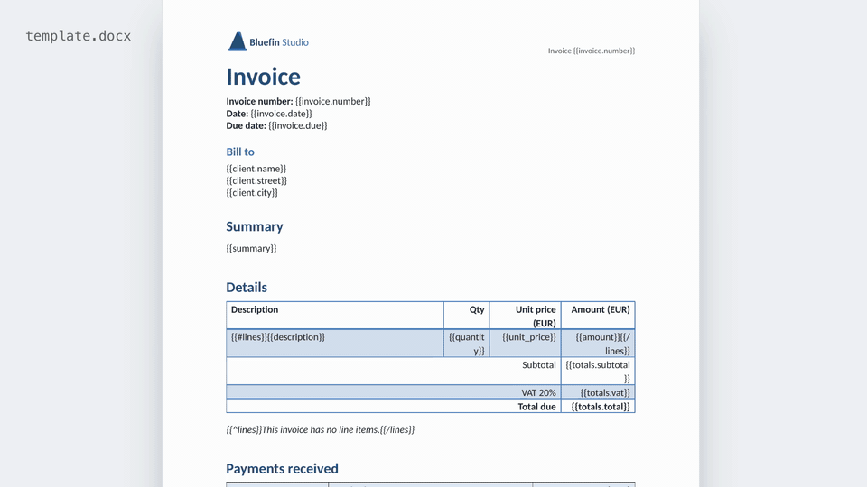
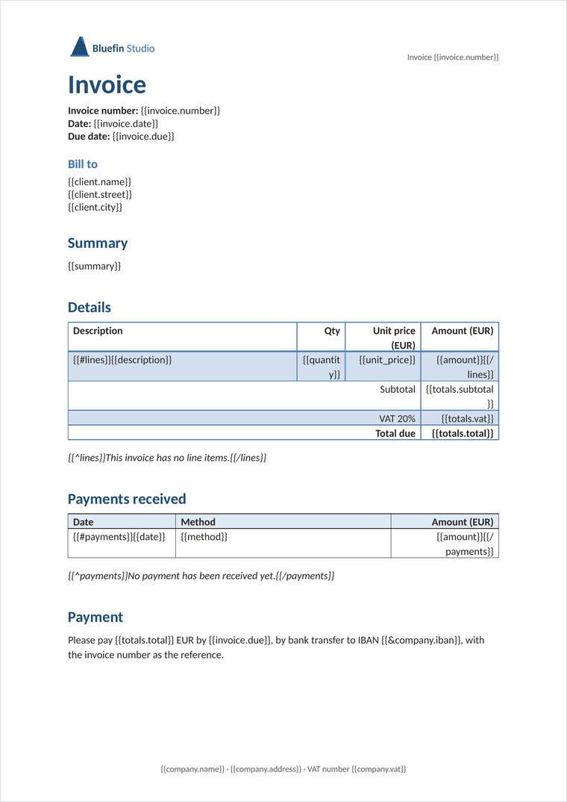
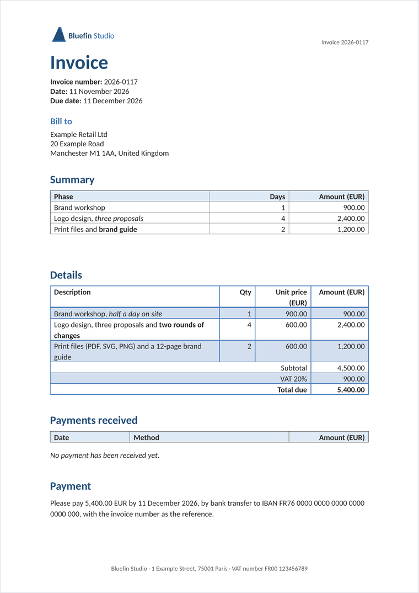
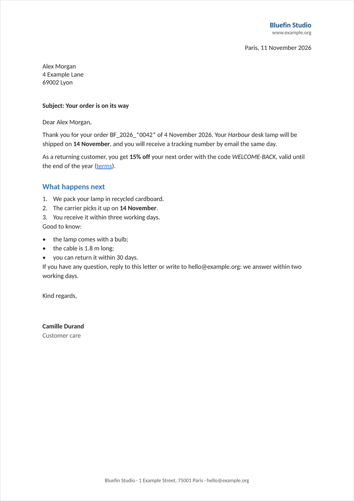
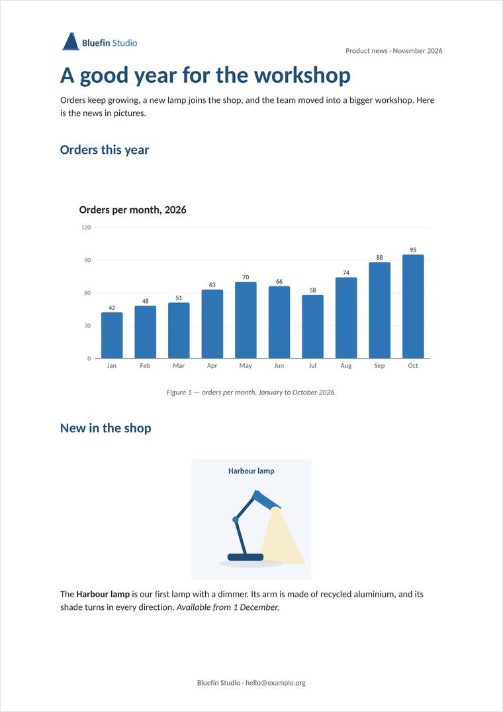
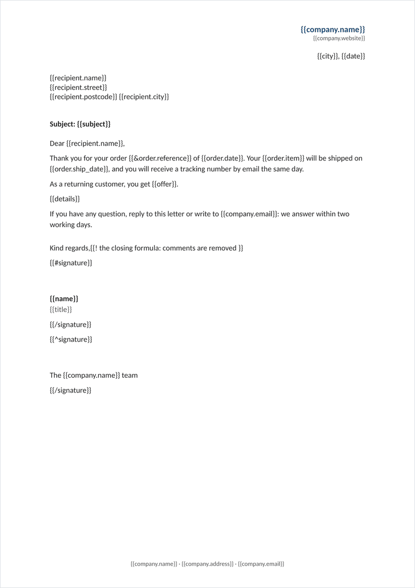
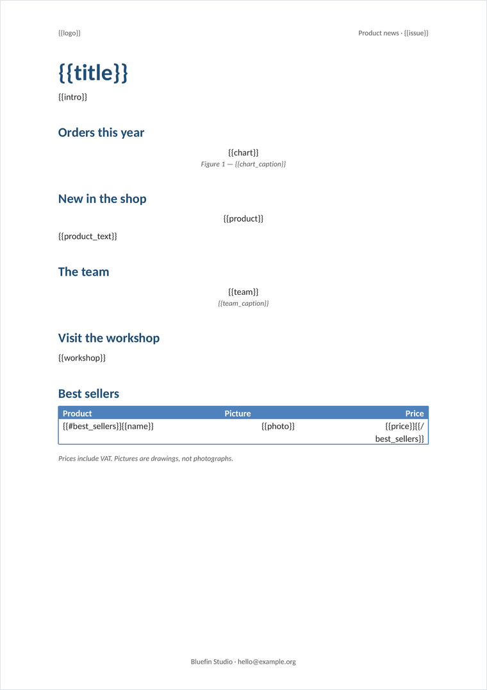

<p align="center"></p>

<h1 align="center">paginel-text</h1>

<p align="center"><b>Fill Word templates with Markdown, from the command line.</b><br>
Type <code>{{placeholders}}</code> in a .docx, keep its styles, fill it from JSON: get a .docx or a PDF.</p>

<p align="center">
  <a href="https://github.com/paginel/paginel-cli/releases/latest"></a>
  <a href="#install"></a>
  <a href="#licence"></a>
  <a href="#privacy-works-offline"></a>
</p>

<p align="center">
  <a href="media/paginel-text.mp4"></a><br>
  <sub>▶ <a href="media/paginel-text.mp4">Watch the 10-second film in full quality (MP4, 1080p, 2.4 MB)</a></sub>
</p>

Type `{{placeholders}}` in a Word document, keep your styles, headers, logos and table styles, and
let `paginel-text` fill them from JSON. Values are Markdown, so a value can be a word in a sentence,
a bold name, a link, a picture, a table, or a whole report with headings, lists and footnotes. The
result is a `.docx` that opens in Word as if you had typed it, or a PDF.

```sh
paginel-text fill template.docx data.json out.docx
```

One binary, no runtime, no account, and it works offline. Linux and Windows (macOS in a later
version). Made by [Paginel](https://paginel.com), the word processor that complements Word; the
same engine as the Paginel app.

<p align="center">
  <a href="#install"><b>Install</b></a> ·
  <a href="#quick-start-60-seconds"><b>Quick start</b></a> ·
  <a href="#examples">Examples</a> ·
  <a href="#privacy-works-offline">Privacy</a> ·
  <a href="#documentation">Documentation</a>
</p>

## How it works

<table>
<tr>
<th>1 · A Word template</th>
<th>2 · Data, values in Markdown</th>
<th>3 · The filled document</th>
</tr>
<tr>
<td valign="top"><a href="examples/03-tables/"></a></td>
<td valign="top">

`data.json`:

`"client": {"name": "Example Retail Ltd", …}`

`"summary"`: a Markdown table

`"lines"`: three items, such as `"description": "Logo design, three proposals and **two rounds of changes**"`

`"payments": []`

</td>
<td valign="top"><a href="examples/03-tables/"></a></td>
</tr>
<tr>
<td valign="top"><code>template.docx</code>: <code>{{client.name}}</code>, <code>{{summary}}</code>, and a table row from <code>{{#lines}}</code> to <code>{{/lines}}</code></td>
<td valign="top">one command:<br><code>paginel-text fill template.docx data.json out/invoice.docx</code></td>
<td valign="top"><code>out/invoice.docx</code> (name it <code>out/invoice.pdf</code> for a PDF)</td>
</tr>
</table>

The table row was repeated once per item and kept the table's style; `**two rounds of changes**`
came out bold; the `summary` value became a real Word table; `payments` is empty, so its row went
away and the template's “No payment has been received yet.” shows instead. Everything else in the
template was copied as it was. The report goes to standard error:

```text
template.docx → out/invoice.docx: 29 values written
Word: blocks kept 6, patched 28, rewritten 1, unrecognized 0; parts rewritten: word/document.xml, word/header1.xml, word/footer1.xml
```

Not sure what a template expects? `paginel-text fields template.docx` lists its placeholders, and
`paginel-text fields template.docx --example` writes a data skeleton to start from.

## Examples

<table>
<tr>
<th>Text</th>
<th>Pictures</th>
<th>Tables</th>
</tr>
<tr>
<td valign="top"><a href="examples/01-letter/"></a></td>
<td valign="top"><a href="examples/02-images/"></a></td>
<td valign="top"><a href="examples/03-tables/"></a></td>
</tr>
<tr>
<td valign="top"><a href="examples/01-letter/"><b>A letter</b></a>: values inside sentences, with bold, italics and links; a whole block with a heading and lists; headers and footers; a signature shown only when the data has one.</td>
<td valign="top"><a href="examples/02-images/"><b>A newsletter</b></a>: a logo in the header, sizes such as <code>width 5cm</code> and <code>width 50%</code>, a floating picture with text around it, pictures in table cells.</td>
<td valign="top"><a href="examples/03-tables/"><b>An invoice</b></a>: a Markdown table in a value, a styled table with a repeated row, totals, an empty list.</td>
</tr>
</table>

<details>
<summary><b>Before and after</b>: the letter and newsletter templates next to their results</summary>
<br>

| Template | Result |
|---|---|
|  |  |
|  |  |

</details>

Two more in [examples/](examples/): [a Markdown report in a company template](examples/04-report/)
(one `{{body}}`, filled from a file) and [a Markdown template](examples/05-markdown-template/) (in
French), to Word, PDF or Markdown. Each folder has its template, its data, a README and the result.

## Highlights

- **Your template stays yours.** Everything the fill does not touch is copied byte for byte: styles,
  theme, numbering, headers and footers, section and page settings, fields, comments, bookmarks.
- **Values are Markdown.** In a sentence, a value takes the placeholder's own font; alone in its
  paragraph, it can become headings, lists, tables, pictures and footnotes, in the template's styles.
- **Loops and conditions**, Mustache style: repeat table rows, paragraphs or list items with
  `{{#items}}…{{/items}}`; show something only when a list is empty or a value missing with
  `{{^items}}…{{/items}}`.
- **Placeholders beyond the body**: tables, headers and footers, footnotes, text boxes, content
  controls and hyperlinks ([where](docs/where-tags-work.md)).
- **Word, PDF or Markdown out**: `.docx`, `.pdf` (PDF/A with `--pdfa`) or `.md`, from a `.docx` or a
  `.md` template.
- **Made for programs and AI agents**: `fields --schema` gives the JSON Schema of the data,
  `--strict` fails instead of leaving gaps, `--json` prints a machine-readable report.
- **Works offline**: no telemetry, no account, no online service ([Privacy](#privacy-works-offline)).

## Install

Download the archive for your system from the
**[latest release](https://github.com/paginel/paginel-cli/releases/latest)**, check it against
`SHA256SUMS.txt`, and put `paginel-text` on your `PATH`.

| System | Archive (version 0.3.0) |
|---|---|
| Linux x86_64, glibc 2.35 or later (Ubuntu 22.04, Debian 12, Fedora 36 and later) | `paginel-text-0.3.0-x86_64-unknown-linux-gnu.tar.gz` |
| Windows 10 and 11, x64 | `paginel-text-0.3.0-x86_64-pc-windows-msvc.zip` |

**There is no macOS build in version 0.3.0**: macOS (Apple silicon) comes in a later version. Each
archive holds a folder of the same name with `paginel-text` (`paginel-text.exe` on Windows), a short
`README.md`, the `LICENSE` and `THIRD-PARTY-LICENSES.txt`. There is no build yet for ARM Linux or
Alpine (musl).

**Linux**, in a terminal:

```sh
VERSION=0.3.0
NAME=paginel-text-$VERSION-x86_64-unknown-linux-gnu
curl -fsSLO https://github.com/paginel/paginel-cli/releases/download/v$VERSION/$NAME.tar.gz
curl -fsSLO https://github.com/paginel/paginel-cli/releases/download/v$VERSION/SHA256SUMS.txt
grep " $NAME.tar.gz\$" SHA256SUMS.txt | sha256sum -c -
tar -xzf $NAME.tar.gz
mkdir -p ~/.local/bin && mv $NAME/paginel-text ~/.local/bin/
~/.local/bin/paginel-text --version
```

- **`PATH`**: if `paginel-text --version` says “command not found”, add `~/.local/bin` to your
  `PATH`: `echo 'export PATH="$HOME/.local/bin:$PATH"' >> ~/.bashrc` (or `~/.zshrc` for zsh), then
  open a new terminal.
- **glibc**: `ldd --version` shows your glibc version (2.35 or later is needed).
- **Update**: run the same commands with the new `VERSION`; pin it in scripts and CI so that a new
  release never changes your documents by surprise.

**Windows**, in PowerShell:

```powershell
$Version = "0.3.0"
$Name = "paginel-text-$Version-x86_64-pc-windows-msvc"
$Base = "https://github.com/paginel/paginel-cli/releases/download/v$Version"
Invoke-WebRequest "$Base/$Name.zip" -OutFile "$Name.zip"
Invoke-WebRequest "$Base/SHA256SUMS.txt" -OutFile "SHA256SUMS.txt"
$Expected = ((Select-String -Path SHA256SUMS.txt -SimpleMatch " $Name.zip").Line -split '\s+')[0]
if ((Get-FileHash "$Name.zip" -Algorithm SHA256).Hash -ne $Expected) { throw "SHA-256 does not match" }
Expand-Archive "$Name.zip" -DestinationPath . -Force
$Dest = "$env:LOCALAPPDATA\Programs\paginel-text"
New-Item -ItemType Directory -Force $Dest | Out-Null
Copy-Item "$Name\paginel-text.exe" $Dest -Force
& "$Dest\paginel-text.exe" --version
```

To call `paginel-text` from anywhere, add that folder to your user `PATH` once, then open a new
terminal:

```powershell
$UserPath = [Environment]::GetEnvironmentVariable("Path", "User")
[Environment]::SetEnvironmentVariable("Path", "$UserPath;$env:LOCALAPPDATA\Programs\paginel-text", "User")
```

The `.exe` needs no Visual C++ runtime. It is not signed by Microsoft during the beta: SmartScreen
may warn if you start it from the Explorer; run from PowerShell or `cmd.exe`, it starts without a
prompt. Messages follow the Windows display language (French or English); `--lang en` or
`--lang fr` chooses.

## Quick start (60 seconds)

**1. A template.** Any `.docx` works. To try without opening Word, start from Markdown (the
commands below are for a Linux shell; on Windows, write the two files with a text editor, in
UTF-8):

```sh
mkdir paginel-demo && cd paginel-demo
cat > hello.md <<'EOF'
# Hello {{name}}!

Your order **{{order}}** ships on {{date}}.

{{notes}}
EOF
```

**2. The data**, as JSON:

```sh
cat > data.json <<'EOF'
{
  "name": "Ada",
  "order": "A-1042",
  "date": "*Friday 13 November*",
  "notes": "Good to know:\n\n- the parcel is **2 kg**;\n- it needs a signature."
}
EOF
```

**3. Fill it:**

```sh
paginel-text fill hello.md data.json hello.docx     # Word
paginel-text fill hello.md data.json hello.pdf      # or a PDF
```

```text
hello.md → hello.docx: 4 values written
hello.md → hello.pdf: 4 values written
```

`hello.docx` has a *Heading 1* “Hello Ada!”, a sentence with *Friday 13 November* in italics, a
paragraph and a real Word bullet list.

Now do the same with a real Word template: open Word, type `Dear {{name}},` and, alone on its own
line, `{{notes}}`; save it as `letter.docx`, and run (no Word at hand? start from
[examples/01-letter](examples/01-letter/)):

```sh
paginel-text fill letter.docx data.json letter-filled.docx
```

The report goes to standard error; the numbers on the `Word:` line depend on your document:

```text
letter.docx → letter-filled.docx: 2 values written
data keys not used (2): date, order
Word: blocks kept 0, patched 2, rewritten 2, unrecognized 0; parts rewritten: word/document.xml, word/numbering.xml
```

The fonts, styles, header and footer of your template stay as they were; `{{notes}}` becomes a
paragraph and a real Word bullet list. The report says which data keys the template did not use.

No JSON file at hand? Give the values on the command line:

```sh
paginel-text fill letter.docx letter-filled.docx --set name=Ada --set notes="Bring the **blue** folder."
```

And to see what a template expects:

```text
$ paginel-text fields letter.docx
name   Markdown, inline [body]
notes  Markdown, block (paragraphs, lists, tables, images) [body]
```

## What's in the box

| Command | Does |
|---|---|
| `paginel-text fill TEMPLATE [DATA] OUTPUT` | fills a `.docx`, `.dotx`, `.docm`, `.dotm` or `.md` template; writes `.docx`, `.pdf` or `.md` |
| `paginel-text fields TEMPLATE` | lists the placeholders a template expects; `--schema` gives a JSON Schema of the data, `--example` a data skeleton |
| `paginel-text convert IN OUT` | converts between Word, Markdown, text and PDF (`.docx` `.md` `.txt` `.pdf` → `.docx` `.md` `.txt` `.pdf`) |
| `paginel-text info FILE`, `save ORIGINAL EDITED OUT` | what was understood of a document; write edits made in Markdown back into the original `.docx` |

**Placeholders** (a Mustache-compatible subset):

| Tag | Means |
|---|---|
| `{{name}}`, `{{client.address}}` | the value, as Markdown |
| `{{&name}}`, `{{{name}}}` | the value as plain text (no Markdown) |
| `{{#items}}…{{/items}}` | repeat for each item of a list (a piece of a line, paragraphs and list items, **table rows**), or show if true |
| `{{^items}}…{{/items}}` | show only if missing, false or empty |
| `{{.}}` | the current item of a list of plain values |
| `{{! note }}` | a comment, removed |

**Values are Markdown**: `**bold**`, `*italic*`, links, `` `code` ``, footnotes, headings, lists,
quotes, tables, pictures (``), page breaks, a little HTML for colours
and sizes. A placeholder inside a sentence gets the inline part, in the placeholder's own font; a
placeholder alone in its paragraph can become headings, lists, tables and pictures, styled with
**the template's own styles**.

**What stays as it was**: everything the fill does not touch is copied byte for byte from your
template: styles, theme, numbering, headers and footers, section and page settings, fields, comments,
bookmarks. A table row repeated with `{{#items}}` keeps its table style, borders and widths.
Placeholders work in the body, tables, headers and footers (first page, even pages, every section),
footnotes, text boxes, content controls and hyperlinks ([where](docs/where-tags-work.md)).

**Safe for automation**: it works [offline](#privacy-works-offline); pictures named in the data are
read only from the data's folder unless you allow more; a value is never read for tags; `--strict`
fails (exit code 3) instead of leaving gaps; `--json` prints a machine-readable report. Exit codes,
options and messages: [docs/cli-reference.md](docs/cli-reference.md).

## Privacy: works offline

`paginel-text` works entirely offline. It contains no networking code and never opens a network
connection itself: no telemetry, no metrics, no update check, no account, no online service.

- **Only your files.** It reads only the files you give it and the pictures they name, and it writes
  only the output file you ask for: no cache, no configuration, no log.
- **Web pictures are never downloaded.** A picture given as a web address (``)
  becomes a grey “image to provide” frame, with a warning; `--strict` makes it an error (exit code 3,
  nothing written):

  ```text
  warning: image “https://example.org/logo.png” of logo not read (network address: never downloaded, give a file): grey “image to provide” frame (body, block 2: “{{logo}}”)
  ```

- **Good to know**: if a file or picture path points to a network share (on Windows, for example
  `\\server\share\logo.png` or `//server/share/logo.png`), your operating system fetches it from
  that share, as it would for any program. Pictures named in the data cannot point there unless you
  pass `--allow-any-path`; a Markdown file you convert, and the pictures typed in a `.md` template,
  can.
- **Your results can still point online.** Links in your data stay links in the result, and a `.md`
  output keeps a web picture's address as text: whoever opens the result can follow them.

Check it yourself on Linux: `strace -f -qq -e trace=network -o net.log paginel-text fill template.docx data.json out.docx`
leaves `net.log` empty.

## Documentation

| Page | |
|---|---|
| [Template syntax](docs/template-syntax.md) | tags, names, inline or block, what counts as empty |
| [Markdown values](docs/markdown-values.md) | what Markdown does in a value, and what Word receives |
| [Pictures](docs/images.md) | paths, formats, sizes, floating pictures, pictures in tables and headers |
| [Tables](docs/tables.md) | a Markdown table in a value, or a template table with repeated rows |
| [Loops and conditions](docs/loops-and-conditions.md) | sections over runs, paragraphs and rows; contexts; nesting; errors |
| [Where placeholders work](docs/where-tags-work.md) | headers, footers, footnotes, text boxes, content controls, hyperlinks |
| [Data](docs/data.md) | JSON, `--set`, standard input, the report; from Python, Node, the shell, CI |
| [Fields](docs/fields.md) | what a template expects: tree, JSON Schema, data skeleton |
| [Command-line reference](docs/cli-reference.md) | every command, option, exit code, message, and the JSON output |
| [Converting](docs/convert.md) | `paginel-text convert`, the Markdown front matter, `save` |
| [Recipes](docs/recipes.md) | company template from Markdown, mail merge, Python, Node, GitHub Actions, Docker, AI agents |
| [Limitations](docs/limitations.md) · [Troubleshooting](docs/troubleshooting.md) · [FAQ](docs/faq.md) | |

Five worked [examples](examples/), each with its template, data and result: a letter, pictures,
tables (an invoice), a report from Markdown, a Markdown template.

## Licence

- `paginel-text` (the binary) is **free**, for any use: at work, on servers, in CI and containers,
  in commercial projects. It is **proprietary**: its source code is not published, and you may not
  modify it, sell it or distribute it on its own (it may go, unmodified, into container, CI and
  virtual machine images). The documents you make with it are yours. See [LICENSE](LICENSE).
- It is provided **“as is”, without warranty** of any kind, and the author accepts **no liability**
  for any damage from its use, to the extent permitted by law. There is no obligation of support,
  corrections or new versions: check what it produces before you rely on it.
- The third-party components it includes are listed, with their licences, in
  `THIRD-PARTY-LICENSES.txt` inside each archive.
- The **documentation and examples** in this repository are under
  [MIT No Attribution](docs/LICENSE): copy them into your projects freely.

Questions, bugs: [open an issue](https://github.com/paginel/paginel-cli/issues), or write to
hello@paginel.com. Security: [SECURITY.md](SECURITY.md).

---

# paginel-text (français)

**Remplir des modèles Word avec du Markdown, en ligne de commande.** Tapez des `{{champs}}` dans un
document Word, gardez vos styles, en-têtes, logos et styles de tableau, et `paginel-text` les remplit
depuis un JSON. Les valeurs sont du Markdown : un mot dans une phrase, un nom en gras, un lien, une
image, un tableau, ou un rapport entier avec titres, listes et notes. Le résultat est un `.docx` qui
s'ouvre dans Word comme si vous l'aviez tapé, ou un PDF.

```sh
paginel-text fill modele.docx donnees.json resultat.docx
```

- **Installer** : l'archive de votre système dans la
  [dernière version](https://github.com/paginel/paginel-cli/releases/latest) (Linux x86_64 avec
  glibc 2.35 ou plus récente, Windows 64 bits ; pas de version macOS en 0.3.0, elle viendra
  ensuite), vérifiée par `SHA256SUMS.txt`, puis `paginel-text` dans votre `PATH` (commandes
  ci-dessus).
- **Balises** : `{{nom}}` (Markdown), `{{&nom}}` (texte brut), `{{#liste}}…{{/liste}}` (répéter un
  morceau de ligne, des paragraphes, des éléments de liste ou des lignes de tableau ; afficher si
  vrai), `{{^liste}}…{{/liste}}` (afficher si absent ou vide), `{{! commentaire }}`. Les noms peuvent
  porter des accents (`{{date_début}}`).
- **Où** : le corps, les tableaux, les en-têtes et pieds de page (première page, pages paires, toutes
  les sections), les notes de bas de page, les zones de texte, les contrôles de contenu et les liens.
- **Fidèle** : tout ce que le remplissage ne touche pas est recopié octet pour octet depuis le modèle.
- **Pour les programmes et les agents** : `paginel-text fields modele.docx --schema` donne le schéma
  JSON des données ; `--strict` échoue (code 3) plutôt que de laisser des trous ; `--json` donne le
  rapport en JSON.
- **Hors ligne**, sans compte (ci-dessous) ; messages en français quand votre système est en
  français (la langue de l'affichage sous Windows ; `--lang fr` ou `PAGINEL_LANG=fr` pour forcer).
- **Exemples** ([examples/](examples/)) : une lettre, une lettre d'information avec images, une
  facture, un rapport Markdown dans un modèle d'entreprise, et un modèle Markdown de compte rendu de
  réunion, en français ([05-markdown-template](examples/05-markdown-template/)). **Documentation**
  (en anglais) : [docs/](docs/).

**Confidentialité : tout hors ligne.** `paginel-text` fonctionne entièrement hors ligne. Il ne
contient aucun code réseau et n'ouvre lui-même aucune connexion réseau : ni télémétrie, ni
métriques, ni recherche de mise à jour, ni compte, ni service en ligne. Une image ``
donnée par une adresse web n'est jamais téléchargée : elle devient un cadre gris « image à fournir »,
avec un avertissement (`--strict` en fait une erreur). Il ne lit que les fichiers que vous lui donnez
et les images qu'ils désignent, et n'écrit que le fichier de sortie demandé (ni cache, ni
configuration, ni journal). Bon à savoir : si un chemin de fichier ou d'image désigne un partage
réseau (sous Windows, par exemple `\\serveur\partage\logo.png` ou `//serveur/partage/logo.png`),
c'est votre système qui va le chercher sur ce partage, comme pour n'importe quel programme ; les
images nommées dans les données ne le peuvent pas sans `--allow-any-path` ; un fichier Markdown que
vous convertissez, et les images écrites dans un modèle `.md`, le peuvent : sous Windows, relisez un
Markdown écrit par quelqu'un d'autre avant de le convertir. Vos résultats peuvent pointer en ligne :
les liens de vos données restent des liens, et une sortie `.md` garde l'adresse d'une image web ; qui
ouvre le résultat peut les suivre.

**Licence** : le binaire est gratuit, pour tout usage, y compris au travail, sur un serveur, en
intégration continue, dans des conteneurs et dans des projets commerciaux. C'est un logiciel
propriétaire : son code source n'est pas publié, et vous ne pouvez ni le modifier, ni le vendre, ni
le diffuser seul (il peut aller, non modifié, dans des images de conteneur, d'intégration continue
ou de machine virtuelle). Il est fourni « en l'état », sans garantie d'aucune sorte et sans responsabilité de l'auteur
dans les limites permises par la loi, sans obligation d'assistance, de correction ni de nouvelle
version ([LICENSE](LICENSE)). Les documents que vous faites sont à vous. La documentation et les
exemples sont sous licence MIT No Attribution.

Contact : hello@paginel.com — [paginel.com](https://paginel.com).
