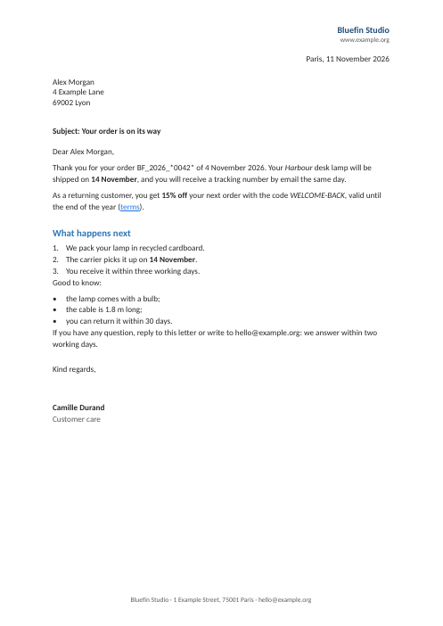

# 01 — A letter: text values

A customer letter in Word. Everything in it is text: short values inside sentences, a value with
Markdown formatting, a whole block (heading and lists) from one placeholder, a value kept as plain
text, placeholders in the header and the footer, and a signature that only shows when the data has one.

```sh
cd examples/01-letter
mkdir -p out
paginel-text fill template.docx data.json out/letter.docx
```



The result: [out/letter.docx](out/letter.docx), and the same as a PDF: [out/letter.pdf](out/letter.pdf).

## What to look at

| In the template | In `data.json` | In the result |
|---|---|---|
| `Dear {{recipient.name}},` | `"recipient": {"name": "Alex Morgan", …}` | *Dear Alex Morgan,* — a dotted name reads inside an object |
| `Your {{order.item}} will be shipped on {{order.ship_date}}` | `"*Harbour* desk lamp"`, `"**14 November**"` | the values are Markdown: *Harbour* in italics, **14 November** in bold, in the sentence |
| `you get {{offer}}.` | bold, italic and a link | the link is a real Word hyperlink |
| `{{details}}` alone in its paragraph | a `##` heading, a numbered list, a paragraph, a bullet list | the paragraph is replaced by real Word blocks: *Heading 2* and Word lists |
| `{{&order.reference}}` | `"BF_2026_*0042*"` | `&` means plain text: the `_` and `*` stay as they are |
| `{{company.name}}` in the header, three values in the footer | `"company": {…}` | headers and footers are filled too |
| `{{#signature}}` … `{{/signature}}`, then `{{^signature}}` … `{{/signature}}` | `"signature": {"name": …, "title": …}` | the signature block shows, with `{{name}}` and `{{title}}` read inside `signature`; the “The Bluefin Studio team” block does not |
| `Kind regards,{{! … }}` | | comments are removed |

The salutation `Dear {{recipient.name}},` is stored in the template the way Word often stores what
you type: the placeholder is cut into three pieces (`{{recip`, `ient.na`, `me}}`) with different
revision marks and a spelling mark in between. You never see it in Word, and the fill does not care.

## Try

- Remove `"signature"` from `data.json`: the letter ends with “The Bluefin Studio team”, and the
  report says `absent sections, taken as false (1): signature`. With `--strict` an absent section
  key fails the fill: write `"signature": false` to drop it on purpose.
- Make a PDF instead: `paginel-text fill template.docx data.json out/letter.pdf`.
- See the placeholders the template expects: `paginel-text fields template.docx`.
