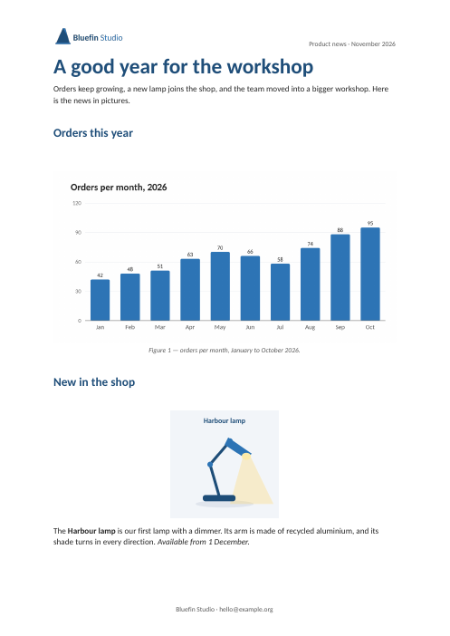

# 02 — Pictures: sizes, placement, tables, headers

A two-page newsletter. Every picture comes from the data, as a Markdown image whose path is relative
to the data file’s folder (`images/…`). The *title* of the image (the text in quotes) sets its size or
its place, with the same words as the Paginel app.

```sh
cd examples/02-images
mkdir -p out
paginel-text fill template.docx data.json out/news.docx
```



The result: [out/news.docx](out/news.docx), and the same as a PDF: [out/news.pdf](out/news.pdf).

## What to look at

| Placeholder | Value in `data.json` | Result |
|---|---|---|
| `{{logo}}` in the header, before a tab and “Product news” | `` | the logo, 1 cm high, inside the header line (a transparent PNG) |
| `{{chart}}` alone in a centred paragraph | `` | no size given: natural size (96 dpi), reduced to the text width; the paragraph stays centred |
| `{{product}}` | `` | 5 cm wide, height in proportion |
| `{{team}}` | `` | half the text width |
| `{{workshop}}` alone in its paragraph | the picture with `"right; width 35%"`, then two paragraphs | a floating picture on the right, the text wraps around it |
| `{{photo}}` in a table cell, in a repeated row | `` | `width 60%` is 60% of **the cell’s** width |

The best-sellers table repeats its second row for each item of `best_sellers`
(`{{#best_sellers}}` in the first cell, `{{/best_sellers}}` in the last one): the copies keep the
table style of the template.

## Good to know

- Paths are relative to the folder of `data.json`. Absolute paths, `..` that leave that folder, and
  web addresses are refused (the picture becomes a grey “image to provide” frame and you get a
  warning); `--allow-any-path` lifts the folder rule, never the web rule. See
  [docs/images.md](../../docs/images.md).
- PNG, JPEG, GIF, WebP and TIFF are read. An SVG is not: convert it to PNG first.
- The pictures were drawn for these examples; like everything in `examples/`, they are under the
  MIT-0 licence: copy them freely.
