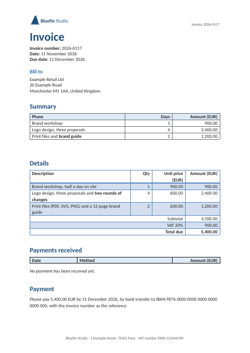

# 03 — Tables: a Markdown table, a styled invoice table, an empty list

An invoice. It shows the two ways to get a table, and what happens when a list is empty.

```sh
cd examples/03-tables
mkdir -p out
paginel-text fill template.docx data.json out/invoice.docx
```



The result: [out/invoice.docx](out/invoice.docx), and the same as a PDF: [out/invoice.pdf](out/invoice.pdf).

## 1. A Markdown table in a value: `{{summary}}`

`{{summary}}` is alone in its paragraph, and its value is a Markdown table:

```markdown
<!-- table: widths 50% 25% 25% -->
| <!-- cell: fill #DEEAF6 --> Phase | <!-- cell: fill #DEEAF6 --> Days | <!-- cell: fill #DEEAF6 --> Amount (EUR) |
|---|---:|---:|
| Brand workshop | 1 | 900.00 |
| Logo design, *three proposals* | 4 | 2,400.00 |
| Print files and **brand guide** | 2 | 1,200.00 |
```

It becomes a new Word table across the text width, with a thin grid. The comment before the table
sets the column widths; the `cell:` comments shade the header cells; `---:` aligns a column to the
right. The header row is bold. This table does **not** take a Word table style: when you want the
template’s look, use the second way.

## 2. A table in the template with a repeated row: `{{#lines}}`

The *Details* table is a real Word table with the *Light Grid Accent 1* style, a header row that
repeats on each page, and three total rows with merged cells. Its second row is:

| `{{#lines}}{{description}}` | `{{quantity}}` | `{{unit_price}}` | `{{amount}}{{/lines}}` |
|---|---|---|---|

`{{#lines}}` in the first cell and `{{/lines}}` in the last cell make the row repeat once for each
item of `lines`. Inside, `{{description}}` is read from the item. The copies keep everything the row
had in the template: style, borders, widths, alignment. The total rows are not in the loop, so they
stay once, at the end.

`paginel-text` does not compute: `amount`, `subtotal`, `vat` and `total` are in the data, computed
by the program that writes it.

## 3. An empty list

`payments` is an empty list (`[]`):

- the *Payments received* table repeats its row zero times: only its header row is left;
- `{{^payments}}No payment has been received yet.{{/payments}}` shows, because `^` means “when the
  list is empty or missing”;
- `{{^lines}}This invoice has no line items.{{/lines}}` does not show, because `lines` has items.

## Try

- Add a payment: `"payments": [{"date": "20 November 2026", "method": "Bank transfer", "amount": "5,400.00"}]`.
- Empty `lines`: the *Details* table keeps its header and total rows, and the sentence
  “This invoice has no line items.” appears.
