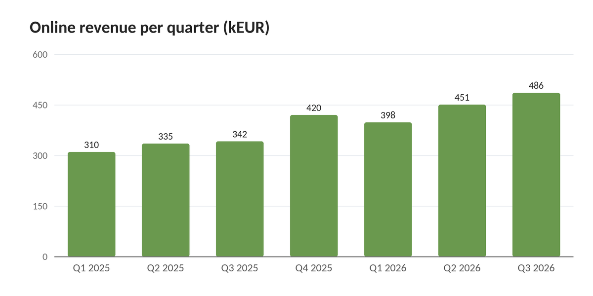
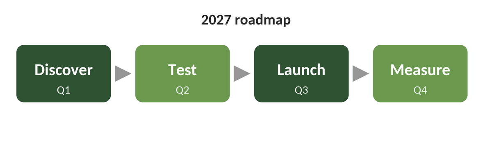

# Executive summary

Online revenue reached **486 kEUR** in the third quarter of 2026, up 42% on the same quarter of 2025.
Most of the growth came from returning customers, who now place *two orders out of three*.[^method]

The year still has two weak spots: deliveries to rural areas take too long, and one visitor in five leaves
the site on the delivery page.

## Key findings

- Returning customers drive the growth:
  - they spend 31% more per order than new customers;
  - they buy again within 45 days on average.
- Mobile is now the main channel:
  - 64% of visits and 52% of orders;
  - the payment page is twice as slow on mobile as on a computer.
- Delivery is the main reason to leave:
  1. the delivery cost is shown too late;
  2. there is no pick-up point option;
  3. rural deliveries take five days on average.

## Revenue by quarter

<!-- table: widths 40% 30% 30% -->
| Quarter | Revenue (kEUR) | Change on a year |
|---|---:|---:|
| Q1 2026 | 398 | +28% |
| Q2 2026 | 451 | +35% |
| Q3 2026 | 486 | +42% |
| **Year to date** | **1,335** | **+35%** |

\newpage

# Recommendations

1. **Show the delivery cost on the product page**, not at the end of the order.
2. **Offer pick-up points** in rural areas, starting with the three regions where deliveries are slowest.
3. **Make the mobile payment page faster**: one page instead of three, and saved cards for returning customers.

> A customer who knows the full price early is a customer who finishes the order.

## Roadmap

The plan runs over four quarters. Each step ends with a short review, so that the next one can change course.

## Next steps

- [x] Share this report with the management team
- [ ] Choose the pick-up point partner (by 15 January)
- [ ] Start the mobile payment project (February)

[^method]: Figures from the online shop's order database, 1 January 2025 to 30 September 2026, excluding refunds.
