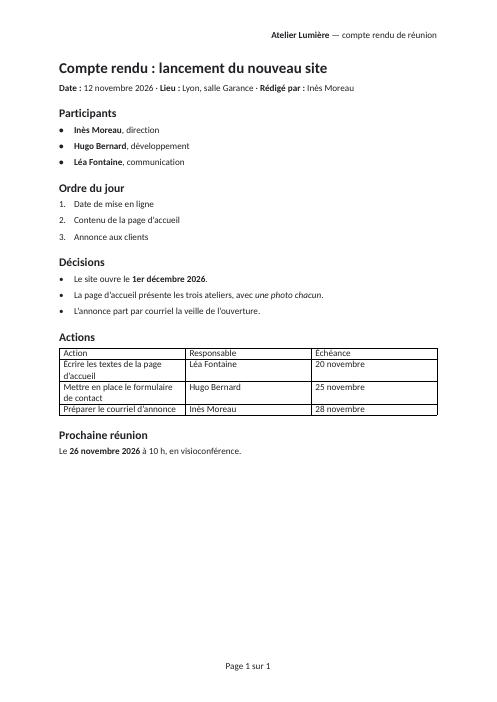

# 05 — A Markdown template (in French)

The template does not have to be a Word file. Here it is a Markdown file, `template.md`, with the
same placeholders. Its front matter sets the paper, the margins, the header and the footer (with page
numbers). The result can be a Word file, a PDF or a Markdown file: the extension of the output
decides.

This one is a meeting report (*compte rendu*) in French: placeholder names may use accented letters
(`{{date_début}}`, `{{rôle}}`).

```sh
cd examples/05-markdown-template
mkdir -p out
paginel-text fill template.md data.json out/compte-rendu.docx
paginel-text fill template.md data.json out/compte-rendu.pdf
paginel-text fill template.md data.json out/compte-rendu.md
```



The result: [out/compte-rendu.docx](out/compte-rendu.docx), and the same as a PDF: [out/compte-rendu.pdf](out/compte-rendu.pdf).

## What to look at

- **Loops over paragraphs**: in a Markdown template, put each section tag alone on its own line.
  This template adds blank lines around them for readability; they are optional:

  ```markdown
  {{#participants}}
  - **{{nom}}**, {{rôle}}
  {{/participants}}
  ```

  gives the same list of three participants. A line that holds only a section tag always stands
  alone, even inside a list.
- **A loop over table rows**: `| {{#actions}}{{tâche}} | {{qui}} | {{quand}}{{/actions}} |`.
- **An object as a section**: in `{{#prochaine_réunion}} … {{/prochaine_réunion}}`, `{{lieu}}` is
  read inside `prochaine_réunion` first (*en visioconférence*), even though the root of the data also
  has a `lieu` (*Lyon, salle Garance*).
- **Inverted sections** (`{{^actions}}`, `{{^prochaine_réunion}}`) show only when the value is
  missing or empty: here, neither shows.
- `{PAGE}` and `{PAGES}` in the front matter’s footer are page numbers (Paginel’s Markdown notation),
  not placeholders.

The PDF uses the fonts built into `paginel-text` (see [docs/limitations.md](../../docs/limitations.md)).
